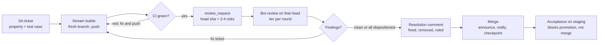

# Branches, PRs and reviewer-bot reviews across streams

> **What this is:** the method an orchestrator (SA) uses to move code from many streams' worktrees to
> `main` and then to production, with an external reviewer bot (here: Codex CLI) as the primary code
> reviewer. It is the companion to the dispatch bus: dispatch says how streams talk; this says how their
> code lands. It keeps no live/design status of its own: that is [`control-plane-spec.md`](control-plane-spec.md)
> §10 only. Everything here is a convention the adopter applies; §8 lists the parts a project replaces.

Several Claude Code sessions build one repo in parallel, each in its own git worktree. SA is the only
session that merges; the operator (the human) may also merge or steer at any point, and SA merging is the
default path, not a lock.

## 1. Roles and lanes

Streams are separated by file scope, not by branch: each owns a lane, opens PRs from its own worktree,
and never merges. SA reviews, orders and merges; the operator decides anything billable, outward or
production-facing.

| Role | Worktree | Opens PRs | Merges |
| --- | --- | --- | --- |
| SA (orchestrator) | the main root | yes, for its own lane | yes (default merger) |
| Build streams (S1, S2, …) | one each, `<repo>-<lane>` | yes | no |
| Probe stream (optional) | pinned to `main` | rarely | no |
| Review stream (optional, CR) | read-only | no | no |

- Lanes come from `config/streams.yaml`; `ownership.yaml` settles overlaps (most specific glob wins).
- `can_merge: true` only for SA. `gen-config.py` denies `gh pr merge` and the GitHub MCP merge tool in
  every other stream's settings; deny both, or the gap stays open.
- A lane is advisory for reading and arbitration for editing: a stream that needs a change in another
  lane asks that stream through dispatch; it does not edit the file.
- Production, prod data, payments and anything that costs money need the operator's own words in that
  session. A go relayed by another stream is not authorization.

## 2. Worktrees and branches

Every stream lives in one long-lived worktree and cuts a fresh, short-lived branch from `origin/main` for
each ticket. Worktrees are permanent; branches are disposable.

**Rules a stream follows**

1. Branch before writing code: `git fetch origin && git switch -c <prefix>/<topic> origin/main`. Never
   commit on `main`; never reuse an old branch for a new ticket.
2. Branch prefixes say what the work is (`feature/`, `fix/`, `docs/`, `test/`, `workflow/`). If the
   merge announcement derives the stream from the branch name, keep the prefixes stream-distinct, and
   still pass the stream explicitly when announcing.
3. One ticket, one branch, one PR. A review fix round is a new commit on the same branch, never a new PR.
4. To pick up a sibling's merge: `git merge origin/main` (or rebase if the PR has no review comments yet).
   After a squash merge of a branch you built on: `git rebase --onto origin/main <pre-squash-sha> <branch>`.
5. Push before reporting. A review request names the pushed head sha; SA reviews that sha, never a
   working tree.
6. After the merge the stream stays idle until the next ticket, which starts from a fresh `origin/main`.

**What SA does with worktrees**

- SA's main root sits at a recent `main` commit and is moved deliberately, never by a `git pull` in
  passing. SA's own PRs are built in a throwaway worktree so the main root stays put.
- SA never switches branches inside another stream's worktree and never moves or deletes one, even when
  the session looks dead.
- Each bot review gets its own throwaway worktree (`git worktree add --detach` on the PR head, removed
  after the run), so a review never touches any stream's checkout.
- A probe stream's worktree stays on `main` (`pinned: true`) so probes run the same tree staging runs.

## 3. Deployment model (recommended)

A merge to `main` ships to staging, never to production. Each app's production follows its own
`release/<app>` pointer branch, and only SA moves a pointer, with the operator's go.

| Step | What happens | Who |
| --- | --- | --- |
| Merge | PR lands on `main`; each app's staging redeploys when that app's paths changed since its last deployed commit | SA |
| Accept | Post-deploy acceptance runs on staging against the candidate sha | probe stream; SA reads the verdict |
| Record | Promotion record: app, sha, that app's successful staging deploy, acceptance verdict bound to the sha, migration status | SA |
| Migrate | Pending migrations on a pre-prod database first, then prod, before the code; additive only | SA, operator's go |
| Promote | `git push origin <sha>:release/<app>`, fast-forward only; only that app rebuilds | SA, operator's go |

- Pointers hold zero commits of their own, so a rollback is a `--force-with-lease` move back of one
  pointer and loses nothing. When there is time, prefer `git revert` on `main` plus a normal promotion.
- "What is on prod?" is `git rev-parse origin/release/<app>`.
- Path filters compare against the last *deployed* commit, not `HEAD^`; otherwise a promotion over
  several commits can skip a build without any error.
- The merge bar becomes "ready to test on staging", not "production-ready". That is what lets SA merge on
  evidence without the operator in the loop for every PR.

## 4. PR lifecycle

A PR moves on dispatch envelopes, not on chat. Every step leaves an envelope, a PR comment or a STATE.md
line.

A fix round never skips a step: the stream pushes, CI runs again, and the bot reviews the new head,
because the review script refuses a head it already reviewed.

1. **Ticket (SA → stream).** A `ticket` envelope states the property to achieve and the case that proves
   it, not the fix shape. It names the base, any PR it must wait for, and whether a design or operator
   approval comes first.
2. **Build (stream).** Fresh branch, code, tests that drive the real producer, not hand-built fixtures.
   Push.
3. **Open the PR (stream).** The body says what changes, why, the test evidence, the acceptance check,
   and a preview URL for UI changes.
4. **Wait for CI (stream).** Read the actual check results on the pushed head. A finished wait is not a
   green run.
5. **Review request (stream → SA).** A `review_request` envelope with the PR number, the head sha, 2–4
   specific risks for the reviewer to check, and "pure rebase" flagged if it is one.
6. **Gate (SA).** Check the lane, read the diff, run the bot at the right depth (§5) on that head.
   Findings → a fix ticket to the stream with each finding and the rule to apply. Repeat until clean or
   every finding is dispositioned.
7. **Resolution comment (SA).** Before merging, SA posts on the PR how each finding ended: fixed in
   `<sha>`, removed, or down-tiered with the reason. No PR merges while showing an open P1.
8. **Merge (SA).** Re-check that the reviewed head is still the PR head and CI is green with current
   `main`, then merge.
9. **Announce (SA).** One merge line per PR in the team channel (link, stream, review rounds and models,
   comment count); a notification envelope to the stream ("merged, stay idle" or the next ticket); a
   checkpoint line in STATE.md.
10. **Accept (probe stream, later).** If the change has an acceptance check, SA tickets the probe stream
    to run it on staging at the candidate sha that will be promoted. The verdict binds to that exact sha;
    promoting any other sha needs its own verdict. The result blocks promotion, not the merge.

## 5. Reviewer-bot reviews

The bot is the primary reviewer and SA triggers it itself: one ephemeral, read-only run per PR head,
posted back to the PR as a comment. A review by another Claude stream is optional and secondary.

**Depth, chosen per round**

| Tier | Model / effort | Use for |
| --- | --- | --- |
| deep | strongest model, high effort | first round of security, auth, migrations, money or core-logic PRs; structural changes |
| standard | strongest model, medium effort | first round of ordinary feature PRs |
| light | smaller model, medium effort | fix rounds on a small delta; docs-only PRs |

Spend deep only where it earns it. Fix rounds go light or standard and are batched: running deep on every
fix round of one PR can exhaust a usage window in an afternoon.

**The review script's contract** (a short shell script around `codex exec` or an equivalent CLI):

- Refuse unless CI on that head is green. Count only the latest run of each check; a docs-only PR with no
  checks by design counts as green.
- Refuse a head that already has a bot comment naming it, so a head is never reviewed twice.
- Review in a detached throwaway worktree on the PR head, diff against `origin/main`, sandbox read-only.
- Prompt in two parts: (A) the focus checks SA passed, each answered explicitly, and (B) a full general
  pass over the diff. The focus list adds checks; it never narrows the review.
- Require `[P1]/[P2]/[P3]` findings with `file:line`, or the literal line "No findings." Match a tag
  anywhere in the output; anything else is logged as `unparsed`, never as clean.
- On a usage or rate limit, write a marker file and refuse every later run until the operator deletes it.
- Append `{pr, head, verdict, tokens, secs, model, effort}` to a JSONL log; the merge announcement counts
  rounds and models from it.
- Post with a fixed signature line so watchers and the "already reviewed" guard can find bot comments.

**Writing the focus.** Two to four risks, one line each, naming the property and the case that would
break it ("an empty list must not fall back to the default card"), taken from the stream's
`review_request` plus SA's own read of the diff. On a re-review, list what was already dispositioned so
it is not re-raised.

**Dispositioning findings.** Tier by what the mechanism would do wrong, not by the bot's confidence.
Each finding ends one of three ways: fixed (the next head is reviewed), removed (the code it flagged is
gone), or dispositioned in writing on the PR (intended behaviour, out of scope with a follow-up, or
wrong, with the evidence). A P1 is never dispositioned as "probably fine".

**When rounds don't converge.** The general pass reads the whole diff every round, so a long document
or a broad PR can surface a new minor finding each time. When the focus checks pass and the new findings
are P2/P3 wording, fix them in one batch, record them in the resolution comment, and run one final light
round on the final head instead of looping.

## 6. Merge gate checklist

A PR merges only when every item below is true for its current head. "Mergeable" on GitHub is not
"merge-ready".

- [ ] The diff stays inside the author stream's lane (or the cross-lane part was agreed through dispatch).
- [ ] The bot ran on this exact head and is clean, or every finding on it is dispositioned on the PR.
- [ ] CI is green on this head, and that run is newer than the last merge to `main` that touches the same
      contract, mocks or migrations. Otherwise re-run CI first.
- [ ] The reviewed head is still the PR head (no push after the review).
- [ ] No merge conflicts with current `main`.
- [ ] Project-specific gates hold (for example an acceptance-check section on core-logic PRs).
- [ ] Holds respected: the PR is not waiting on a sibling, an operator choice or a parked decision.
- [ ] Resolution comment posted on the PR.

After the merge (not part of the gate): announcement posted, notification envelope to the stream,
STATE.md checkpoint.

Without branch protection, the cheapest enforcement is a merge wrapper that SA uses instead of raw
`gh pr merge`: it re-reads the required CI check on the PR head at merge time and refuses unless it is
green, with any override logged. Extending it to the other legs (a bot comment naming the current head,
no undispositioned P1, a resolution comment present) turns most of this checklist into a check.

## 7. Coordinating several PRs

When two PRs share a contract, the producer merges first and the consumer rebuilds on it. SA decides the
order in the tickets, before anyone writes code.

- **Producer before consumer.** The API PR that adds a field merges first; the UI PR that shows it is
  held, regenerates its types from the merged contract, merges `main`, and only then is reviewed. A
  consumer built against hand-written mocks of an unmerged contract can pass CI while showing nothing on
  staging.
- **Holds.** A held PR gets an explicit envelope saying what it waits for. When the hold lifts, SA sends
  an explicit go; "you can build now" in passing is not a go.
- **Stale CI.** After any merge, every open PR that touches the same contract, mocks or migrations needs
  a fresh CI run before it can merge. A green run from before the sibling merge proves nothing about the
  combination.
- **Fetched refs are snapshots.** SA reads `origin/<branch>` or the GitHub API for the PR head, never a
  local PR ref fetched earlier.
- **Parked PRs.** A parked PR stays open and untouched, is listed in every status report so it is not
  forgotten, and is not rebased until it is unparked.

### Failure modes each rule prevents

Porting a rule without its reason invites someone to remove it.

| Failure mode | Rule |
| --- | --- |
| Consumer built on mocks of a free-string contract key; data invisible on staging, CI green | Producer merges first; consumer tests drive the real producer; enums, not free strings |
| A PR merged on a CI run older than a sibling's merge; `main` broke | Re-run CI after any sibling merge that shares contract, mocks or migrations |
| Streams idle for days on an "info" that meant go | When a gate lifts, send each unblocked stream an explicit go ticket |
| Deep review on every fix round exhausted the bot's usage window | Deep only for first, structural or money rounds |
| A PR merged while still showing an open P1 | Resolution comment on the PR before every merge |
| A finding written "A: [P2]" slipped past a line-start parser and was posted as clean | Match tags anywhere; only the literal "No findings." is clean |
| A review request sent after a finished wait that was actually red | Read the CI result itself before a review request |
| SA's watcher lapsed and missed a review request | Keep the dispatch watcher armed; check the inbox and the open-PR list before saying a stream did not send |
| A merge retargeted open PRs onto `main` and untested code went straight to production | `main` = staging; per-app release pointers; promotion only with a record |
| Tests passed in a working tree that differed from the pushed commit | Verify `git show HEAD:` and the pushed `origin/<branch>`, not the working tree |
| SA sent throwaway envelopes as another stream; they became real work items | Never dispatch as another stream |

## 8. What a project replaces

| Part | Keep as is | Replace per project |
| --- | --- | --- |
| Roles | one default merger; streams open PRs only; merge denied in their settings | stream names, lanes, path ownership |
| Branching | branch per ticket from `origin/main`; push before review; review names the head sha | branch prefixes |
| Deployment | trunk = staging; per-app production pointers moved only with a record | app list, hosts, migration step, shared-package rules |
| Review bot | the script contract in §5 | CLI path, the three model tiers, repo name |
| Gate | the §6 checklist, resolution comment, stale-CI rule, producer before consumer | domain gates |
| Announce | one line per PR with rounds, models, comments; stream notified; STATE checkpoint | channel, language, mention |
